<a href="https://belikhun.dev"></a>

hi, i'm Belikhun, a fullstack web engineer from Vietnam. i have been building things since 2017, and most of them are on [belikhun.dev](https://belikhun.dev).


<a href="https://github.com/Belikhun?tab=repositories&sort=stargazers"></a>
<a href="https://github.com/Belikhun?tab=repositories&sort=stargazers"></a>
<a href="https://github.com/Belikhun?tab=repositories&sort=stargazers"></a>
<a href="https://github.com/Belikhun?tab=repositories&sort=stargazers"></a>
<a href="https://github.com/Belikhun?tab=repositories&sort=stargazers"></a>

This repository is that site: one long page read by scrolling, built with Bun, SvelteKit, SCSS, GSAP and Lenis, and hosted on my own harbor.

## Running it

```
bun install
bun run dev        # dev server on :8500
bun run check      # svelte-check
bun run build      # static site in build/
bun run banner     # redraw the banner above from the site's hero (needs Python + Pillow)
```

## Licence

The code is under the [MIT License](LICENSE). That does not cover what is not mine to license: the avatar illustration, the Vloom marks, the osu! counters in `static/counters/` and the Noto Animated Emoji in `static/emoji/` (Google, CC BY 4.0) keep their own terms.
